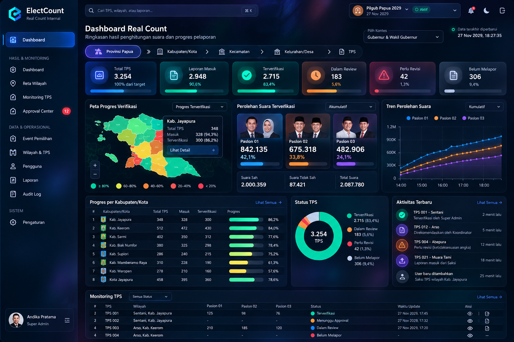

# ElectCount V1 — AI Agent Development Pack

**Status:** approved baseline for planning; not authorization to implement every feature at once.
**Product:** private, single-party election TPS reporting and internal real-count aggregation.
**Primary language:** Indonesian for UI and business explanations; English for code identifiers.

## Development status

Phases 1–7 are implemented for local MVP review with Laravel 13, Vue 3, Inertia, TypeScript, Tailwind, and Sanctum. The application includes scoped multi-event administration, Papua geography/TPS management, witness and proxy reporting, private evidence, coordinator review, Super Admin final approval, verified-result aggregation, responsive dashboards, OCR assistance, exports, audit logs, alerts, and local backup tooling.

The default local database includes only the fixed Papua baseline (1 province, 8 regencies, and 1 city). Super Admin enters or imports districts and villages/urban villages, then creates TPS records individually. Production launch still requires owner-approved descendant geography and TPS counts, MFA and hardened production configuration, PostgreSQL/Redis/private object storage, supervised queue and scheduler services, encrypted off-site backups, and measured staging load tests.

### Local setup

```bash
composer install
npm install
php artisan key:generate
php artisan migrate --seed
npm run build
php artisan serve
```

The default `.env.example` targets PostgreSQL and Redis. Automated tests override the database with in-memory SQLite. Local seeding creates one clearly synthetic account for UI review only: `admin@electcount.test` with password `password`; never use this fixture in production.

## Start here
1. Read `AGENTS.md` (binding agent rules).
2. Read `docs/PRD.md`, `docs/DECISIONS.md`, `docs/ARCHITECTURE.md`, `docs/SECURITY.md`.
3. Check `docs/WORKFLOWS.md`, `docs/DATA_MODEL.md`, `docs/API.md`, `docs/UI_UX.md` and `ui/SCREEN_SPECS.md` before implementing related modules.
4. Follow `docs/IMPLEMENTATION_PLAN.md`; **one phase at a time**. Do not write code until Phase 0 review is approved.
5. Follow `docs/TEST_PLAN.md` and report actual commands/results.

## Locked product choices
- Single-party, internal use; one deployment, multiple election events.
- Geographic event scope: one province **or** one kabupaten/kota.
- V1: **real count only**, internal and provisional, not official election certification.
- Three roles: `super_admin`, `coordinator`, `witness`.
- **Only Super Admin** can give final approval; no self-approval.
- Witness and coordinator may submit reports within assigned TPS/region.
- Both manual entry and OCR-assisted input planned; OCR is advisory, never auto-approved.
- Online-only V1; responsive web now, Flutter mobile **later**.
- Dark Glassmorphism with a **single dashboard and geographic drilldown**.

## UI references


This mockup is **illustrative**, not a source of election facts, real candidates, valid geography, or numerical consistency. Refer to `ui/SCREEN_SPECS.md` for implementable behavior.

## Documentation map
| Document | Purpose |
|---|---|
| `AGENTS.md` | binding scope and agent behavior |
| `docs/PRD.md` | product requirements and acceptance criteria |
| `docs/DECISIONS.md` | locked, proposed, and unresolved choices |
| `docs/ARCHITECTURE.md` | Laravel application design and integrations |
| `docs/REPO_STRUCTURE.md` | repository structure and coding conventions |
| `docs/ROLES_PERMISSIONS.md` | access matrix and scope enforcement |
| `docs/DATA_MODEL.md` | relational entities, invariants, and aggregation |
| `docs/WORKFLOWS.md` | state transitions and verification |
| `docs/API.md` | versioned API conventions and examples |
| `docs/SECURITY.md` | security controls and threat model |
| `docs/UI_UX.md` | tokens, responsiveness, and accessibility |
| `ui/SCREEN_SPECS.md` | screen inventory, layout, interactions, mockup mapping |
| `ui/WIREFRAMES.md` | text-based wireframes for desktop and mobile |
| `docs/TEST_PLAN.md` | automated tests and acceptance checks |
| `docs/IMPLEMENTATION_PLAN.md` | milestones, phase gates, and stop conditions |
| `docs/DEPLOYMENT.md` | environments, operational readiness |
| `templates/TASK.md` | per-task instruction template |

## Agent launch prompt
> Read `AGENTS.md` and the documents it references. Perform **Phase 0 only**: identify contradictions, unresolved dependencies, risk areas, and a minimal implementation proposal. Do not write code, install packages, or create migrations. Wait for explicit approval.
