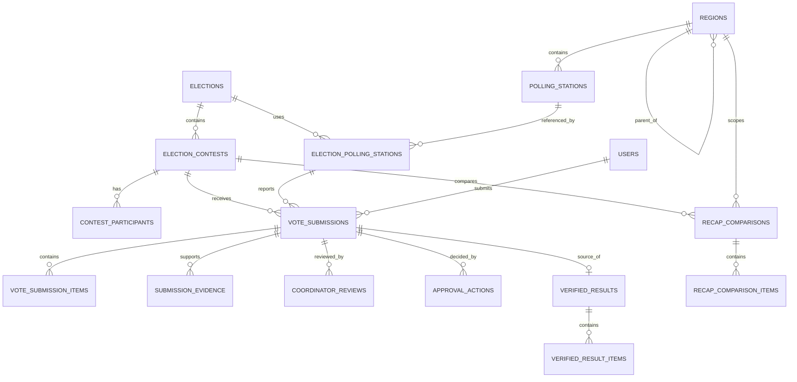

# Data Model & Invariants

## Core entities
| Table | Important columns / purpose |
|---|---|
| `users` | id, name, login, password_hash, role, status, mfa settings |
| `elections` | id, name, year, type (`pilkada`/`pileg`), scope_region_id, status |
| `election_contests` | id, election_id, type, ballot_schema_version, status |
| `regions` | id, code, name, level, parent_id, valid_from/to |
| `election_regions` | election_id, region_id, snapshot metadata |
| `polling_stations` | id, region_id, code, number, location label |
| `election_polling_stations` | id, election_id, polling_station_id, eligibility/status |
| `contest_participants` | id, contest_id, party_id?, candidate_id?, display_order |
| `parties` | reusable party name, abbreviation, private logo, active status |
| `election_parties` | one party registration and ballot number per Pileg event |
| `electoral_districts` | event-owned Dapil name and status |
| `electoral_district_regions` | districts covered by a Dapil; no district may be ambiguous inside one event |
| `electoral_district_parties` | Pileg parties participating in each Dapil |
| `participant_supporting_parties` | Pilkada coalition parties for a candidate pair |
| `event_assignments` | user_id, election_id, role/context |
| `region_assignments` | user_id, election_id, region_id |
| `tps_assignments` | user_id, election_id, election_polling_station_id |
| `vote_submissions` | id, election_id, contest_id, event_tps_id, submitter_id, status, idempotency_key, submitted_at, version |
| `vote_submission_items` | submission_id, participant_id, votes, ballot_dimension |
| `vote_submission_totals` | submission_id, valid_votes, invalid_votes, extra form fields |
| `submission_evidence` | submission_id, storage_key, sha256, media_type, uploaded_at |
| `ocr_jobs` | evidence_id, status, engine, version, confidence, extracted_data |
| `coordinator_reviews` | submission_id, reviewer_id, recommendation, notes, created_at |
| `approval_actions` | submission_id, admin_id, action, reason, created_at |
| `verified_results` | id, election_id, contest_id, event_tps_id, source_submission_id, active, verified_at, supersedes_id |
| `verified_result_items` | verified_result_id, participant_id, votes, ballot_dimension |
| `recap_comparisons` | immutable event/contest/region snapshot, level, version, idempotency key, automatic and official totals, discrepancy flag, private evidence metadata/checksum |
| `recap_comparison_items` | comparison_id, participant_id, ballot_dimension, automatic_votes, official_votes, delta |
| `audit_logs` | actor_id, action, object_type/id, before/after hash, timestamp |
| `geography_imports` | actor, BPS/KPU source/version, private file path, checksum, preview summary, status |

## Logical ERD

## Integrity constraints
- Unique region code within its official version and correct parent; prohibit cycles.
- Event TPS unique by `(election_id, polling_station_id)`.
- Contest participant unique by `(contest_id, participant identity, ballot dimension)` as applicable.
- Idempotency key unique within submitter/operation context.
- Only one **active** verified result per `(election_id, contest_id, event_tps_id)`; enforce with PostgreSQL partial unique index.
- Nonnegative integer vote counts; totals validated against approved contest form schema.
- Submission immutable after submit; corrections create new submission/version.
- Evidence immutable and private; never use publicly guessable paths.
- Region imports reject invalid hierarchy, cycles, duplicate codes, and non-Papua roots; committed imports update only draft/preparing event snapshots.
- TPS provisioning is idempotent by `(region_id, number)` and event membership by `(election_id, polling_station_id)`.
- Recap comparisons are append-only and unique by both request idempotency key and scope version; they never activate, replace, or add a verified result.
- A recap snapshot records its TPS count/time and automatic totals. Later approvals may make that snapshot stale, which is exposed dynamically rather than rewriting history.

## Aggregation example
For each eligible TPS in requested descendant region set, select its active verified result for selected contest; sum `verified_result_items` grouped by participant and ballot dimension. Derive submitted/verified counts by **distinct event TPS**, not submission count. Reconcile dashboard sums against raw verified records.

## Legislative warning
Store direct party-symbol votes with ballot dimension `party` and candidate votes with ballot dimension `candidate`. A party result is derived as its direct party votes plus all candidate votes across the selected TPS scope. The valid-vote denominator sums the raw dimensions once; it never adds a derived party result back to candidate results. A candidate belongs to exactly one party and one Dapil, while party aggregation may continue from TPS through province level.
