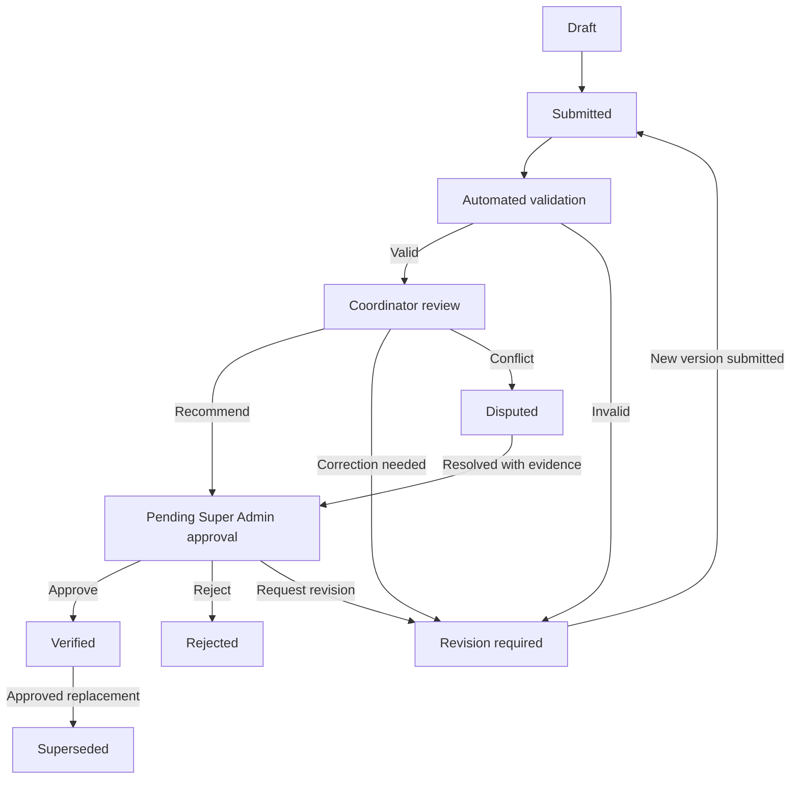

# Workflows & State Machine

## Event lifecycle
`draft → preparing → active → final_review → closed → archived`.
Only Super Admin changes lifecycle; opening a closed event requires logged exceptional procedure.

## Submission lifecycle

When no coordinator is assigned, Super Admin may review directly **provided the Admin did not submit that report**.

## Witness input
1. Authenticate, choose assigned TPS and contest.
2. Upload private evidence; manual input or OCR extraction, explicitly confirm numbers.
3. Backend validates approved contest schema and consistency.
4. Submit once with idempotency key; server returns immutable submission ID.
5. Monitor status; revisions produce new versions and keep originals.

## Coordinator alternate input
1. Select TPS within assigned region and identify witness/source of report.
2. Submit evidence and figures; preserve provenance.
3. Cannot recommend their own submission as independent reviewer.
4. If duplicate report exists, compare submissions and escalate discrepancy.

## Super Admin final approval
1. Open pending queue and inspect original evidence, numbers, coordinator recommendation, anomalies.
2. Check role, event, no-self-approval, valid current version.
3. Approve/reject/request revision with reason; approval is atomic.
4. Approval creates/activates verified result, deactivates replaced result if correction, emits aggregate refresh, writes audit log.

## Correction after verification
Create replacement submission linked to previous verified version; preserve original; repeat review and final approval. If rejected, old verified result remains active. On approval, switch active version atomically.

## Conflict handling
Multiple submissions for same TPS+contest remain distinct. Do not sum or silently pick latest. Flag dispute, compare evidence, resolve with documented Super Admin decision.

## Progress semantics
Submitted: distinct TPS with a submitted version. Verified: distinct TPS with active approved version. Both computed per contest and scope. Multiple contest reports from one TPS must not inflate a single contest's count.

## Official recap comparison
1. Super Admin selects an active contest and an accessible district, regency/city, or province.
2. The server computes one snapshot from eligible TPS with active verified results; for Pileg it preserves direct-party and candidate ballot dimensions without double counting.
3. Super Admin enters the official recap figures and uploads the private official document.
4. The server stores a new immutable, checksummed version and flags participant, invalid-vote, and total differences without changing verified TPS results.
5. Coordinator may inspect comparisons inside the assigned region but cannot create them; Witness has no recap access.
6. A later TPS approval does not mutate an older comparison. The UI marks its snapshot stale and shows the current difference against the latest aggregate.

Final approval and recap creation lock the same contest row before changing or reading the aggregate. This keeps their lock order consistent and prevents a recap snapshot from observing only part of an approval transaction.
