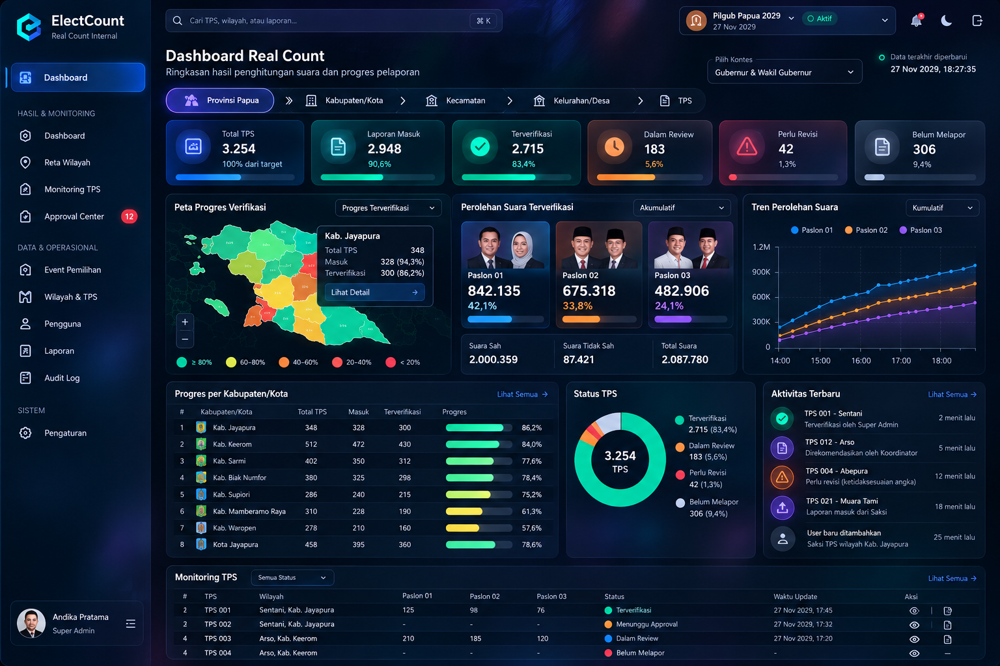

# Screen Specifications & Mockup Mapping

**Mockup notice:** All votes, people, dates, TPS counts, and map shapes are synthetic illustration. Production implementation must calculate figures from backend and use validated geography.

## 1. Login
- Branded dark-glass panel; username/password; clear errors; MFA step for admin.
- No public dashboard or guest access.

## 2. Dashboard (all roles, scoped)
- Header: ElectCount logo, search (authorized data only), event picker, contest picker, user menu, freshness indicator.
- Region breadcrumb: Province > Kab/Kota > Kecamatan/Distrik > Desa/Kelurahan > TPS (render only valid ancestors).
- KPI cards: Total TPS, Laporan Masuk, Terverifikasi, Dalam Review, Perlu Revisi, Belum Melapor.
- Middle row: region map (if approved GeoJSON available), verified vote distribution, trend chart (historical snapshot only, no fabricated data).
- Lower row: child-region progress table, status distribution, activity feed, TPS monitoring table.
- Clicking row/map area drills into that region; clicking TPS opens detail context.
- All counts computed **per contest**; dashboard labels clearly state internal/provisional.

## 3. TPS Detail
- Header: event, contest, region chain, TPS number, current status.
- Evidence viewer, submitted numeric values, computed totals, reporter identity (scope-limited), version history.
- Super Admin: approval controls if eligible; coordinator: review/recommend; witness: read status and edit new draft if revision requested.

## 4. Witness Reporting
- Mobile-first single column; assigned TPS selection; contest selector; numeric inputs; photo upload; optional OCR suggestions; review screen; submit.
- Disable submission until required fields/evidence and backend validations pass.
- Retry safely on timeout with same idempotency key.

## 5. Coordinator Review
- Filter assigned TPS by status; compare form image and numbers; recommend or request correction; source/provenance visible.
- Cannot recommend own submission.

## 6. Approval Center (Super Admin only)
- Queue by event/contest/region/status; details with evidence and numbers; approve/reject/revision with reason; explicit confirmation.
- Prevent self-approval; stale report handling; anomalies require individual review.

## 7. Admin Screens
- Events & contests; master regions/TPS; users & assignments; audit log; exports; settings.
- Consistent glass UI but prioritize clear forms, pagination and safety confirmations.

## 8. Empty, loading, error
- No TPS: show scope-specific empty state.
- No verified votes: show 0 + "Belum ada hasil terverifikasi", not fake bars.
- Unauthorized: 403 without revealing data.
- Stale cache: display last updated and refresh state.

## UI acceptance checklist
- Desktop screenshot review at 1440×900 and mobile at 390×844.
- Sidebar/drawer and role menus correct.
- Breadcrumb back/forward and direct-link region navigation correct.
- Evidence image zoom works; input fields usable on touch.
- No layout overflow, low contrast, or unreadable glass effects.
